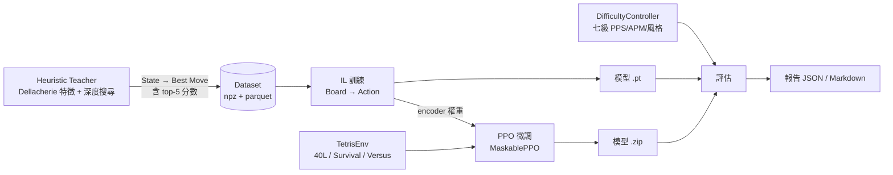

# 13. 運作原理詳解：IL、PPO 與七級難度保真度

這份文件回答三個問題：

1. **模仿學習（IL）到底在學什麼、怎麼學？**
2. **PPO 為什麼能超越教師、訓練時該看什麼？**
3. **「七級難度保真度」是在量什麼、為什麼需要它？**

所有數字都是本專案實際跑出來的（2026-09 於本機 i5-13500H / CPU 與 Colab）。

---

## 0. 先看整體資料流



三者的分工可以這樣理解：

| 元件 | 角色 | 打個比方 |
|---|---|---|
| Heuristic Teacher | 產生「正確答案」 | 教練示範標準動作 |
| IL | 把教師的行為壓縮成神經網路 | 選手照著教練的方式練到一模一樣 |
| PPO | 用 reward 突破教師 | 選手開始自己比賽、找出教練沒教的贏法 |
| DifficultyController | 控制「這個選手要多強」 | 調整選手的手速、反應、失誤率 |
| 難度保真度 | 驗證控制器真的有效 | 體檢：說好 3.0 PPS 就是 3.0 PPS |

---

## 1. 模仿學習（IL）的運作細節

### 1.1 訓練資料從哪來

教師（`agents/heuristic_agent.py`）對每個盤面：

1. 用 BFS 列出所有合法落點（`envs/engine/placement.py`，含 hold 變體）
2. 對每個落點算 Dellacherie 特徵（landing height、eroded piece cells、row/column transitions、holes、well sums）+ 現代偏好項（Tetris / T-Spin / PC / Combo / B2B）
3. 加權總分排序，取最高分當「標準答案」，同時保留**前 5 名的分數**

`scripts/generate_dataset.py` 用 multiprocessing 平行產生，每筆樣本長這樣：

| 欄位 | 形狀 | 說明 |
|---|---|---|
| `board` | (2, 20, 10) uint8 | 佔用格 + 垃圾格 |
| `vector` | (160,) float16 | 方塊 / hold / 佇列 / 統計 / action mask |
| `mask` | (80,) uint8 | 哪些動作合法 |
| `action` | int16 | 教師的最佳落點 |
| `topk_actions` / `topk_scores` | (5,) | 前 5 名的動作與分數 |

實測速度：本機 8 workers 約 **262 sample/s**（147 萬筆約 1.5 小時）。

### 1.2 模型看到什麼、要輸出什麼

* **輸入**：`board` (2×20×10) 影像 + 160 維向量（方塊 one-hot、hold、next queue 7 顆、combo/b2b、垃圾行、統計數字、action mask）
* **輸出**：80 個動作的 logits（`(column, rotation, hold)` 的編碼）
* 這麼設計的重點是**動作空間是「落點」而不是「按鍵」**：一顆方塊 = 一個決策，信用分配（credit assignment）容易得多。

### 1.3 網路結構

```
board (B,2,20,10) → ResNet/SmallCNN 編碼器 → 128 維
vector (B,160)    → MLP(160→256)          → 256 維
concat(384) → Linear(384→256)+ReLU+LayerNorm → fusion 256 維
            ├─ policy head → 80 個 logits
            └─ value  head → 1 個 state value
```

參數量（`python -m scripts.model_summary` 實測）：`small_cnn` 577 K、`resnet` 739 K。

### 1.4 Loss 怎麼算（這是 IL 的核心）

```python
loss = masked_cross_entropy(logits, target, mask, label_smoothing=0.02)
     + 0.3 * KL(教師 top-5 分佈 ‖ 學生分佈)
```

**第一項：masked cross-entropy**

80 個動作裡通常只有 40 幾個合法（實測平均 43.6/80）。非法動作在 forward 時被壓到 `-1e9`，
所以 loss 必須**只對合法動作**計算。若直接用 `cross_entropy(label_smoothing>0)`，
平滑項會把 52% 的 `-1e9` 一起平均進去：

```
CE（無 smoothing） = 3.41
CE（smoothing=0.02）= 10,500,003   ← 實際踩到的 bug（見 docs/12 Bug 1）
```

**第二項：top-5 soft target**

教師的「第二名」常常也是好選擇。我們把前 5 名的分數做 per-sample min-max 正規化，
除以溫度 0.5 後 softmax 當作軟標籤，再算 KL。這樣模型學到的是「這幾個都不錯，第一個最好」，
而不是被單一答案綁死。同時**只保留合法且分數有限的候選**，避免 `-inf` 或遮罩值滲進 loss。

### 1.5 訓練設定（`configs/il.yaml`）

| 項目 | 值 | 說明 |
|---|---|---|
| train / val | 90% / 10% | 依固定 seed 切分 |
| batch size | 256 | |
| optimizer | AdamW，lr 3e-4，weight decay 1e-5 | |
| epochs | 30（early stopping patience 5） | top-1 連續 5 個 epoch 沒進步就停 |
| grad clip | 1.0 | |
| label smoothing | 0.02 | |
| top-k | 3 個（溫度 0.5） | |

### 1.6 指標怎麼看

| 指標 | 意義 | 怎麼判斷好壞 |
|---|---|---|
| `train_loss` / `val_loss` | 分類損失 | 80 類的**隨機基線是 ln(80) ≈ 4.38**；4.3 → 3.5 代表在學，2 以下代表學得不錯 |
| `top1` | 預測動作 = 教師最佳動作 | 精確匹配，最嚴格 |
| `top3` | 教師前三名有中 | 寬鬆版 |
| `top1_tolerant` | 預測落點的**教師分數**與最佳差距 ≤ 0.5 | 本專案的關鍵指標，見下 |

**為什麼 top-1 有天花板**：實測 20.8% 的樣本「第一名與第二名分數差 < 0.5」、13.6% 差 < 0.1 ——
這些狀態下有兩個實質等價的落點，教師只是取排序第一個，標籤本身等於雜訊。
所以我們另外量 `top1_tolerant`（平手容忍準確率）來反映真正的決策品質。

實測學習曲線（28,800 樣本、`small_cnn`、batch 512、本機 CPU）：

| epoch | train_loss | val_loss | top1 | top3 | top1_tolerant |
|---|---|---|---|---|---|
| 5 | 3.212 | 3.177 | 0.300 | 0.536 | 0.326 |
| 10 | 2.624 | 2.787 | 0.371 | 0.629 | 0.401 |
| 20 | 1.756 | 2.430 | 0.471 | 0.718 | 0.505 |
| **28（最佳）** | 1.283 | 2.373 | **0.485** | **0.734** | **0.518** |

epoch 28 之後 train 1.28 / val 2.37 已經開始過擬合 —— 這時要加的是**資料**，不是 epoch。

### 1.7 checkpoint 裡有什麼

```python
{
  "model": state_dict,      # TetrisNetwork
  "optimizer": ...,         # 可續訓
  "epoch": 28,
  "metrics": {"train_loss": ..., "val_loss": ..., "top1": ..., "top3": ..., "top1_tolerant": ...},
  "extra": {"network": "small_cnn", "config": {...}},   # 讓 PolicyAgent 自動辨識架構
}
```

⚠️ **小樣本驗證與正式訓練會存到同一個 `best.pt`**。用 `--limit 20000` 跑完只會得到 top-1 ≈ 0.08 的模型，
訓練時會印出提醒；`PolicyAgent` 載入時也會再警告一次。

### 1.8 什麼時候算「訓練成功」

1. loss 明顯低於 4.38 且持續下降
2. top-1 達到 `configs/il.yaml` 的階段目標（目前設 0.45 / top3 0.70 / tolerant 0.50）
3. **行為驗證**：把模型丟進 40L，能穩定完成、時間與教師差距在 ±15% 內

---

## 2. PPO 的運作細節

### 2.1 為什麼 IL 之後還需要 PPO

IL 的上限就是教師 —— 教師不堆 Tetris，IL 也就不會堆。但我們要的是「攻擊力高、APM 高」的 AI，
而這種行為在教師資料裡幾乎不存在。PPO 用 reward 直接告訴模型「送垃圾行是好的」，
讓它自己找出教師沒教的路線。

### 2.2 環境怎麼跑

| 設定 | 值 | 說明 |
|---|---|---|
| env | `TetrisSurvival-v0` | 也可換 `40l` / `versus` |
| n_envs | 8（Colab）/ 4（本機） | `SubprocVecEnv` 平行收集 |
| VecMonitor | **必要** | 產生 `info["episode"]` 與 `ep_rew_mean`；少了它 `best.zip` 永遠不會出現（docs/12 Bug 5） |
| action mask | `ActionMasker` + `MaskablePPO` | 機率只分配給合法動作，不會選到不存在的落點 |

### 2.3 網路與 IL 熱啟動

PPO 用的是**同一個 encoder**（`TetrisNetwork` 包成 `TetrisFeaturesExtractor`），
後面接 SB3 的 `net_arch=[256,256]` actor/critic。

熱啟動就是把 IL 訓練好的 encoder 權重載進 PPO：

```python
trainer = PPOTrainer(config)      # configs/ppo.yaml 的 train.il_warm_start
trainer.run(total_timesteps=2_000_000)
# [PPOTrainer] IL warm start：95/95 個張量已載入
```

**必須是同一種網路架構**。IL 用 `small_cnn`、PPO 用 `resnet` 時只會載入 17/95 個張量 ——
等於從隨機策略開始練，實測結果是模型只活 7.5 顆方塊就 top out。
現在匹配率 < 80% 會直接印出警告。

### 2.4 Reward 與課程

PPO 最佳化的就是 `envs/reward.py` 的這些分項（完整說明見 [07_reward.md](07_reward.md)）：

| 分項 | 值 | 作用 |
|---|---|---|
| 存活 | +0.01 / 步 | 基本訊號，不能主導學習 |
| 消行 | single 1 / double 3 / triple 6 / tetris 12 | 非線性，鼓勵堆 Tetris |
| T-Spin | mini 4 / single 8 / double 14 / triple 20 | 鼓勵進階技巧 |
| Combo / B2B | 每級 +0.5（上限 10）/ B2B ×1.5 | 鼓勵連續消行 |
| Perfect Clear | +30 | 極難但一次清空 |
| Top Out | −20 | 必須大於一次 Tetris，否則 AI 會用命換分 |
| 垃圾行 | 送出 +0.4/行、被打 −0.3/行 | versus 模式才有意義 |
| 形狀 | 新洞 −0.5、洞數 −0.05、高度 −0.02、bumpiness −0.05 | 密集塑形，讓學習訊號不稀疏 |

**課程**：訓練進度前 20% 存活獎勵 ×1.5（先學會不死），後段攻擊獎勵 ×1.5（開始追攻擊）。
由 `env.reward.set_progress()` 驅動，`CurriculumCallback` 每個 rollout 更新一次。

### 2.5 超參與訓練迴圈

| 超參 | 值 |
|---|---|
| `n_steps` × `n_envs` | 512 × 8 = 4096 步 / rollout |
| `batch_size` / `n_epochs` | 1024 / 4 |
| `gamma` / `gae_lambda` | 0.997 / 0.95 |
| `clip_range` | 0.2 |
| lr / ent_coef / vf_coef | 2.5e-4 / 0.01 / 0.5 |

迴圈：**收集 4096 步 → 算 GAE → 用同一批資料更新 4 個 epoch → 存 checkpoint → 重複**。
每 50 k 步存一次 `ppo_*_steps.zip`，平均 reward 創新高時另存 `best.zip`。

### 2.6 訓練時該看什麼

| 指標 | 正常長相 | 異常代表 |
|---|---|---|
| `time/fps` | 本機 70–110、T4 500+ | 掉太多 → n_envs 或網路太大 |
| `rollout/ep_rew_mean` | 逐步上升 | 一直不動 → reward 太稀疏或策略卡住 |
| `train/approx_kl` | 0.0001–0.02 | 超過 0.05 → lr 太大、策略震盪 |
| `value_loss` | 穩定下降 | 一直很大 → value 學不動（本專案 reward 尺度大，數百是正常的） |
| `explained_variance` | 上升、接近 0.5+ | 接近 0 → value 沒有預測力 |

### 2.7 什麼情況會壞掉（實例）

從**隨機策略**開始 PPO（沒有成功熱啟動）時，模型會收斂到退化行為：

```
mean_pieces: 7.5       ← 7 顆方塊就死
hold_rate: 1.0         ← 每顆都按 hold
top_out_rate: 1.0
mean_holes_final: 13   ← 7 顆方塊就疊出 13 個洞
```

結論：**這個任務的 PPO 需要好的 IL 起點**。先確定 IL 的 top-1 有 0.4 以上，再進 PPO。

### 2.8 評估 PPO 模型

SB3 的模型是 `.zip`，要用 `PPOAgent`（`scripts/evaluate.py` 會依副檔名自動選擇）：

```powershell
python -m scripts.evaluate --agent ppo --model checkpoints/ppo/best.zip --env-id Tetris40L-v0 --episodes 3
```

---

## 3. 七級難度保真度（Difficulty Fidelity）

### 3.1 它要解決的問題

需求是「**同一個模型**能模擬從新手到神級的不同玩家」。但「像新手」不能只是感覺 ——
必須量測：說好 Beginner 是 0.5 PPS、10 APM，跑出來就真的要是那個數字。

**保真度 = 實際表現與目標值的相對誤差。**

### 3.2 七級的控制點

每一級都是同一組參數的不同數值（`configs/difficulty.yaml`），由五個子模組實現：

| 目標 | 由誰控制 | 機制 |
|---|---|---|
| PPS（每秒落子） | `TokenBucket` | 速率限制器；每顆方塊至少間隔 `1/target_pps` 秒 |
| 反應 / 思考時間 | `ReactionModel` | `reaction_ms + think_ms + 抖動`，每顆方塊重新抽樣 |
| APM（每分鐘攻擊） | `APMGovernor` | 滾動視窗監控攻擊輸出，超標就延遲出手或改選低攻擊落點 |
| 操作失誤 | `MisplayModel` | 以 `misplay_chance` 的機率依分數加權挑次佳落點 |
| 打法風格 | `StyleBias` + 啟發式權重覆寫 | T-Spin / PC / Combo / Hold / 攻擊偏好 |

風格不是只改標籤，而是真的改寫啟發式權重（`DifficultyController._apply_style_weights`）：

```python
weights["attack_bonus"]          = 20.0 * (0.5*combo_pref + 0.5*tspin_pref)
weights["tspin_bonus"]           = 25.0 * tspin_pref
weights["perfect_clear_bonus"]   = 30.0 * pc_pref
weights["combo_bonus"]           =  8.0 * combo_pref
weights["hold_used_penalty"]     = -3.0 * (1.0 - hold_usage)
```

所以 Godlike（T-Spin 偏好 0.85）真的會去找 T-Spin，Beginner（0.0）完全不會。

### 3.3 保真度量了哪些東西

`evaluators/difficulty_eval.py` 對每一級跑短局，然後算：

| 指標 | 定義 | 意義 |
|---|---|---|
| `pps_error` | `abs(observed − target) / target` | 節奏準不準（**主要驗收指標**） |
| `apm_error` | 同上，但針對 APM | 僅供參考，因為 APM 是上限語意（見 3.5） |
| `apm_ceiling_ok` | `observed_apm ≤ target_apm × 1.05` | 有沒有守住「不能超過這級該有的攻擊量」 |
| `monotonic_pps` | 七級目標 PPS 是否嚴格遞增 | 防止設定檔被改壞 |
| `tspin_rate` / `hold_rate` / `mean_lines` | 風格指標 | 確認不同等級的打法真的不同 |

量測方式刻意用 **`FakeClock`**（可手動推進的假時鐘）而不是真實時間：
這樣同一份評估每次跑出來的數字完全一樣，可以當成 regression test。

### 3.4 怎麼跑、怎麼讀

```powershell
python -m scripts.evaluate --difficulty-suite --max-steps 25
```

輸出：

```json
{
  "mean_pps_error": 0.0021,
  "max_pps_error": 0.0062,
  "mean_apm_error": 0.91,
  "max_apm_error": 1.0
}
```

* `max_pps_error = 0.0062` → 七級裡最差的一級，實際 PPS 與目標只差 **0.6%** ✅
* `apm_error` 大是因為多數等級的實際 APM 遠低於上限（見下）

### 3.5 實測結果（本機、20 步短局）

| 等級 | 目標 PPS | 實測 PPS | 誤差 | 目標 APM（上限） | 實測 APM | 上限符合 |
|---|---|---|---|---|---|---|
| Beginner | 0.50 | 0.50 | 0.6% | 10 | 0.5 | ✅ |
| Casual | 0.90 | 0.90 | 0.1% | 20 | 3.0 | ✅ |
| Intermediate | 1.40 | 1.40 | 0.1% | 35 | 4.8 | ✅ |
| Advanced | 1.90 | 1.88 | 0.8% | 55 | 0.0 | ✅ |
| Expert | 2.40 | 2.39 | 0.4% | 80 | 0.0 | ✅ |
| Professional | 3.00 | 2.99 | 0.3% | 110 | 0.0 | ✅ |
| Godlike | 3.60 | 3.60 | 0.0% | 150 | 4.7 | ✅ |

**PPS 是精確可控的（誤差 < 1%）**，因為它由 token bucket 直接決定。

**APM 只保證「不超過上限」**：實際攻擊量取決於策略積不積極。目前的策略主體是保守的啟發式教師
（不堆 Tetris、不主動攻擊），所以實際 APM 只有 0–5。要讓實際 APM 追上 50–150，
必須靠 PPO 的攻擊導向 reward 把它練出來 —— 這是「控制器負責節奏、模型負責企圖心」的分工。

### 3.6 驗收門檻

| 項目 | 門檻 | 目前 |
|---|---|---|
| PPS 保真度 | 七級誤差 ≤ 5% | 最大 0.8% ✅ |
| APM | 七級都不超過目標上限 | 全部符合 ✅ |
| 單調性 | 目標 PPS/APM 嚴格遞增、失誤率遞減 | 由 `tests/test_difficulty.py` 鎖定 ✅ |

---

## 4. 三者怎麼配合（實務順序）

| 階段 | 做什麼 | 成功條件 | 指令 |
|---|---|---|---|
| 1. 資料 | 教師產生 State → Best Move | 有 manifest、樣本數足夠（10 萬以上） | `python -m scripts.generate_dataset --episodes 200 --workers 8` |
| 2. IL | 學會教師的行為 | top1 ≥ 0.45、損失明顯低於 4.38 | `python -m scripts.train_il --epochs 30` |
| 3. PPO | 超越教師、學會攻擊 | `ep_rew_mean` 上升、`best.zip` 出現 | `python -m scripts.train_ppo --timesteps 2000000 --n-envs 8` |
| 4. 評估 | 對局指標 + 七級保真度 | 40L 完成率、PPS 誤差 ≤ 5% | `python -m scripts.evaluate --difficulty-suite` |

---

## 5. 常見問題（FAQ）

**Q：IL 的 train_loss 一直在 4.3 附近，是壞掉了嗎？**
A：4.38 是「80 類均勻亂猜」的損失。跑幾個 epoch 就會掉到 4.0 以下；卡住不動才需要檢查
（最常見原因：用 `--limit` 跑小樣本、或標籤與 observation 不對齊）。

**Q：IL 的 train_loss 變成幾百萬？**
A：那是 [Bug 1](12_known_issues.md)：`label_smoothing` 把被遮罩的 `-1e9` 一起平均。
現在的程式已修好，若你用的是舊版請更新。

**Q：為什麼 top-1 只有 0.5 就說「訓練成功」？**
A：因為 20.8% 的教師標籤本身是等價落點（分數差 < 0.5），精確匹配有結構性上限。
看 `top1_tolerant` 更接近真實決策品質。

**Q：PPO 的 `best.zip` 沒出現？**
A：1) 確認跑到足夠 steps（`BestModelCallback` 需要至少 3 局結束）；
2) 確認 `VecEnv` 有包 `VecMonitor`（Bug 5 已修）。

**Q：PPO 訓練 reward 一直往下掉？**
A：先檢查 IL 熱啟動的 `loaded/total` 是否相等（< 80% 會警告）。從隨機策略開始，
這個任務會退化成「一直 hold」的壞策略。

**Q：難度保真度裡 APM 誤差 90% 是正常的嗎？**
A：是。`target_apm` 是**上限**不是目標；要讓實際 APM 追上，需要先完成 PPO 訓練。

**Q：想驗證「同一模型能模擬不同等級」要看哪個數字？**
A：`max_pps_error`（節奏）+ `tspin_rate` / `hold_rate` 隨等級遞增（風格）。
