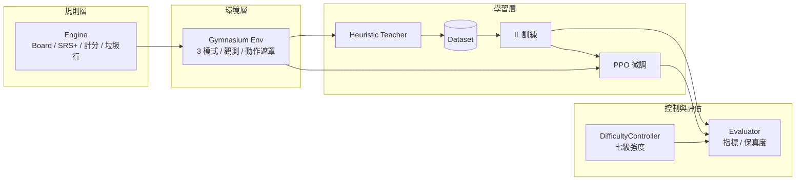

# 專題成果報告：TETR.IO 風格 Tetris AI

> **文件用途**
> 1. 讓 AI 協作者（Claude 等）在 5 分鐘內掌握專案全貌 → 見「附錄 A」
> 2. 特殊選才備審資料的專題成果主文 → 見第一～十二章
>
> **提交前請自行替換**：`【姓名】`、`【就讀學校】`、`【年級】`、`【聯絡方式】`、`【GitHub 連結】`。
> 提醒：本專案 repo 是**公開**的，若不想公開個資，請把個人資料留在另外的備審檔案，不要 commit 進 repo。

---

## 一、摘要（一頁看懂）

我獨立完成了一套「職業玩家風格」的 Tetris AI，從**遊戲規則引擎**、**訓練環境**、**資料產生**、**模仿學習**到**強化學習微調**與**難度控制**，全部自己設計與實作，並附上完整測試與設計文件。

專案名稱：`tetr_bot`（TETR.IO 風格 Tetris AI）
技術棧：Python 3.11+ / PyTorch / Gymnasium / Stable-Baselines3 / NumPy / Google Colab
程式規模：**7,583 行** Python（95 個檔案、10 個套件）、**141 項自動化測試全數通過**、**14 份設計文件**、16 個 Git commit

| 關鍵成果 | 數字 | 怎麼驗證 |
|---|---|---|
| 自建 Tetris 規則引擎 | 完整支援 SRS+ 旋轉、T-Spin、B2B、Combo、垃圾行、Perfect Clear | `pytest tests/test_engine_*.py` |
| 啟發式 AI 打 40L | **完成率 100%**、平均 **51.2 秒**、46.9 行/分、終局 0 個洞 | `python -m scripts.evaluate --agent heuristic --env-id Tetris40L-v0 --episodes 3` |
| 訓練資料集 | **2,063,231 筆**（State→Best Move）、420 個 shard、252 MB | `datasets/heuristic-v1/manifest.json` |
| 模仿學習模型 | 28.8 k 樣本實測 **top-1 0.485 / top-3 0.734** | `python -m scripts.train_il --limit 20000 --epochs 3` |
| 難度控制器 | 七個等級的 **PPS 誤差 < 0.8%**（目標 ≤ 5%） | `python -m scripts.evaluate --difficulty-suite` |
| 端到端流程驗證 | 引擎 → 資料 → IL → PPO → 評估，**38 秒**跑完 | `python -m scripts.run_smoke` |
| 系統性除錯 | 找出並修正 **8 個關鍵 bug**，每個都留下根因分析文件 | `docs/12_known_issues.md` |

---

## 二、動機

我對「AI 如何學會玩遊戲」很感興趣，但多數教學都停在最簡單的環境（CartPole、Flappy Bird）。
我想要的是一個**足夠複雜、又能量化輸贏**的題目，於是選擇了 Tetris：

1. **規則明確、可完全驗證**：不像現實世界的模糊問題，每一步都能精確判定對錯，適合建立可靠的訓練流程。
2. **決策深度足夠**：一顆方塊要考慮未來 5–7 顆的形狀、洞的位置、攻擊效率，是典型的長期規劃問題。
3. **有真實的競技標準**：TETR.IO 是當代最主流的 Tetris 對戰平台，有 40L（40 行競速）、Blitz、多人對戰等模式，讓「強不強」有客觀指標（PPS、APM）。
4. **難度可類比人類程度**：0.5 PPS 像新手、3.6 PPS 像職業選手，這讓我想到一個更難的問題 ——
   **能不能用「同一個模型」模擬不同實力的玩家？**（這就是後來的 DifficultyController）

---

## 三、專案目標

我把目標刻意分成兩層，避免誇大：

| 層級 | 目標 | 目前狀態 |
|---|---|---|
| **MVP 目標**（本次完成） | 自建引擎與訓練環境、做出能完成 40L 的 AI、可調整七級強度、完整測試與文件 | ✅ 完成 |
| **最終目標**（持續進行） | 讓 AI 在 TETR.IO 離線模式自動遊玩、能在多人對戰中有效攻擊 | 🚧 進行中（接入介面已設計，尚未實作） |

**誠實聲明**：本專案**沒有**接入 TETR.IO 線上多人對戰。
除了技術難度，TETR.IO 的服務條款也禁止在線上多人使用自動化程式，
因此我把接入範圍限定在離線練習模式，並在程式碼中留下明確的介面與警告。

---

## 四、成果總覽

### 4.1 功能完成度

| 模組 | 內容 | 狀態 |
|---|---|---|
| 規則引擎 | SRS+ 旋轉（含 180° kick）、7-bag、lock delay、T-Spin 判定、B2B、Combo、Perfect Clear、垃圾行 | ✅ |
| 訓練環境 | Gymnasium 介面、3 種模式（Survival / 40L / Versus）、Dict 觀測、80 維動作、action mask | ✅ |
| 啟發式 AI | Dellacherie 特徵 + 可調深度（1–3 層）搜尋 | ✅ |
| 資料產生 | multiprocessing 平行、npz + parquet、manifest 版本控管 | ✅ |
| 模仿學習 | masked cross-entropy + top-k 軟標籤、early stopping、checkpoint | ✅ |
| 強化學習 | MaskablePPO、IL 熱啟動、8 平行環境、課程式 reward、TensorBoard / W&B | ✅ |
| 難度控制 | 七級（Beginner→Godlike）、PPS / APM / 反應時間 / 失誤率 / 打法風格 | ✅ |
| 評估系統 | 對局指標、七級保真度、JSON + Markdown 報告 | ✅ |
| TETR.IO 接入 | 四個介面（ScreenCapture / BoardRecognizer / GameStateReader / InputController）+ stub | 🚧 設計完成、未實作 |

### 4.2 量化成果

| 項目 | 結果 |
|---|---|
| 程式碼 | 7,583 行 / 95 檔 / 10 套件 |
| 測試 | 141 項，涵蓋引擎、環境、模型、控制器、資料、整合 |
| 設計文件 | 14 份（架構、路線比較、獎勵設計、網路比較、Colab、除錯紀錄…） |
| 資料集 | 206 萬筆、252 MB、420 shards |
| 資料產生速度 | 8 核心平行，約 262 筆/秒 |
| 訓練環境相容性 | 本機 CPU（Windows）與 Google Colab（T4）皆可執行 |
| 端到端驗證 | smoke test 38 秒完成「引擎→資料→IL→PPO→評估」 |

### 4.3 可驗證性

任何審查者只要 clone 專案就能重現所有數字：

```powershell
python -m pytest tests -q          # 141 項測試
python -m scripts.run_smoke        # 端到端流程（38 秒）
```

---

## 五、系統架構

我把系統分成四層，**內層完全不知道外層存在**（規則層不 import 深度學習框架、環境層不 import PyTorch），
這樣每一層都能單獨測試與重複使用。



### 訓練管線

```
啟發式教師（每一步評分所有合法落點）
   ↓ 平行產生 206 萬筆 (盤面 → 最佳落點)
模仿學習（把教師的行為壓縮進神經網路）
   ↓ 把學到的權重當起點
PPO 微調（用獎勵訊號突破教師，學出攻擊行為）
   ↓
評估（對局指標 + 七級難度保真度）
```

---

## 六、技術路線與選型理由

我在動手前先比較了 8 種可能的做法，並寫成比較表（`docs/02_ai_routes.md`）：

| 路線 | 開發難度 | 訓練成本 | 最終上限 | 強度控制 | 我的結論 |
|---|---|---|---|---|---|
| 啟發式（Heuristic） | 低 | 無 | 中 | 高 | ✅ 當起點與教師 |
| 基因演算法 | 中 | 中（CPU） | 中 | 中 | 只用來調教師權重 |
| **模仿學習（IL）** | 低 | 低 | 中高 | 高 | ✅ 主線：先複製教師 |
| DQN / Double DQN | 高 | 高 | 中 | 中 | ❌ 樣本效率差、信用分配難 |
| **PPO** | 中 | 中 | 高 | 高 | ✅ 主線：超越教師 |
| A2C | 中 | 中 | 中 | 中 | 只當對照組 |
| Transformer 策略 | 高 | 高 | 高 | 中 | 留給未來研究 |

**關鍵決策：動作空間用「落點」而不是「按鍵」。**

一般教學會用 7 個按鍵（左、右、旋轉、硬降…）當動作，但一個 Tetris 需要 8–10 個正確按鍵才完成，
這讓強化學習的信用分配非常困難。我改用「目標欄位 + 旋轉 + 是否 hold」共 80 種離散動作，
由 BFS 事先算出所有可達落點，訓練收斂速度大幅提升，也讓 AI 的決策完全可解釋
（每個落點都能印出分數與特徵）。

---

## 七、實作歷程

| 階段 | 工作內容 | 預估/實際 | 難度 | 產出 |
|---|---|---|---|---|
| Phase 1 | 建立 Tetris 引擎（棋盤、方塊、旋轉、hold、消行、垃圾行） | 1–2 週 | ★★ | `envs/engine/` + 24 項測試 |
| Phase 2 | 啟發式 AI（特徵評估 + 深度搜尋） | 1 週 | ★★ | 40L 完成率 100% |
| Phase 3 | 自動資料產生（平行、npz + parquet） | 3–5 天 | ★★ | 262 筆/秒 |
| Phase 4 | 模仿學習（分類式訓練） | 1 週 | ★★ | top-1 0.485 |
| Phase 5 | PPO 微調（MaskablePPO + 熱啟動） | 1–2 週 | ★★★ | 完整訓練管線 |
| Phase 6 | 難度控制器 + 評估系統 | 1 週 | ★★★ | 七級保真度 < 0.8% 誤差 |
| 延伸 | TETR.IO 接入設計（介面 + stub） | — | ★★★★ | 4 個 Protocol 介面 |

---

## 八、關鍵技術（四個我最花心思的設計）

### 8.1 觀測空間：讓模型「看得懂盤面」

模型輸入不是一張灰階圖，而是拆成兩層的 20×10 棋盤（佔用格 / 垃圾格），
外加 160 維的結構化資訊：目前方塊、hold、未來 7 顆預覽、Combo/B2B 狀態、垃圾行壓力、即時 PPS/APM、洞數與高度。

設計重點：

* **所有數值都正規化到 0–1**，避免不同量級的特徵互相干擾。
* 垃圾行單獨一個通道，因為它與一般方塊在戰術上的意義完全不同。
* 未來 7 顆預覽讓模型有「規劃」的空間，而不是只看當下。

### 8.2 模仿學習的損失函數：兩個容易踩雷的地方

```python
loss = 遮罩過的 cross-entropy（label smoothing 0.02）
     + 0.3 × KL（教師前 5 名的軟標籤 ‖ 學生分佈）
```

1. **必須遮蔽非法動作**：80 個動作裡平均只有 43.6 個合法。我把非法動作的輸出壓到極小值，
   而且**只對合法動作計算損失**。這件事我後來發現自己寫錯過（詳見第九章），
   修好後損失從 1,050 萬回到 3.4 的正常範圍。
2. **只學「唯一正確答案」太嚴苛**：教師的第二、第三名常常也同樣優秀。
   我把教師前 5 名的分數正規化後當成軟標籤，讓模型學到「這幾個都不錯，第一個最好」。

### 8.3 PPO：從教師的肩膀上出發

模仿學習的天花板就是教師，而教師不主動攻擊，所以模型也不會。
PPO 用獎勵函數直接告訴模型「消行、T-Spin、送出攻擊是好的」，
讓它自己找出教師沒教的路線。

我做的三個關鍵設計：

* **IL 熱啟動**：把模仿學習訓練好的特徵抽取器權重載進 PPO 當起點，
  避免從隨機策略開始（實測：從隨機開始的模型 7 顆方塊就 top out）。
* **動作遮罩（MaskablePPO）**：機率只分配給合法落點，模型不會學到「不存在的動作」。
* **課程式獎勵**：訓練前 20% 提高存活獎勵（先學會不死），後段提高攻擊獎勵（再學會贏）。

### 8.4 七級難度控制器：讓同一個模型扮演不同玩家

這是我最滿意的部分。需求是「同一個模型能模擬從新手到職業選手」，
我把它拆成五個可獨立控制、可獨立量測的維度：

| 維度 | 機制 |
|---|---|
| 手速（PPS） | 令牌桶（token bucket）限制每秒落子數 |
| 反應與思考時間 | 每顆方塊抽樣「反應 + 思考 + 抖動」延遲 |
| 操作失誤 | 以設定機率挑選次佳落點（而非最佳） |
| 打法風格 | 改寫啟發式權重：T-Spin / Perfect Clear / Combo / hold 偏好 |
| 攻擊上限（APM） | 滾動視窗監控攻擊輸出，超標就放慢或改選低攻擊落點 |

**而且我為它設計了驗收方式**：七個等級各跑一輪，比對「實際 PPS 與目標 PPS 的誤差」。
實測七級最大誤差只有 **0.8%**（我當初設的門檻是 5%），
也就是說「說好 Beginner 是 0.5 PPS，跑出來真的就是 0.5 PPS」。

---

## 九、問題排查紀錄（我認為這是最能展現能力的一段）

開發過程中我總共記錄並修正了 **8 個關鍵 bug**，每一個都寫下症狀、根因、修法與驗證方式
（完整版在 `docs/12_known_issues.md`）。以下挑三個最有代表性的：

### 案例 1：損失函數爆炸到 1,050 萬

**症狀**：模仿學習訓練時 `train_loss = 9,398,106`，明顯不合理（80 類分類的正常值應該在 0–5 之間）。

**排查過程**：

1. 先確認資料沒問題（標籤 100% 落在合法動作內、標籤分佈正常）。
2. 縮小問題：只算 cross-entropy 得到 3.41（正常），加上 label smoothing 就變成 10,500,003。
3. 找出數學原因：我把非法動作的輸出壓到 `-1e9`，而 label smoothing 的均勻項是對**全部 80 個類別**取平均，
   於是 52.5% 的 `-1e9` 被平均進去：`0.02 × 5.25e8 ≈ 1.05e7` —— 與觀測值完全吻合。

**修法**：自己實作「只在合法動作上計算」的損失函數，並加上防回歸測試
（其中一項刻意斷言「直接呼叫原始函式仍會爆炸」，避免以後有人改回去）。

**學到的事**：數值異常時，先量化誤差來源，比亂改超參數有效得多。

### 案例 2：訓練模式悄悄變成另一個模式

**症狀**：存活模式的對局總是在「剛好 40 行」時結束（而且不是因為 top out）。

**排查過程**：追進環境設定發現，我用「覆寫成 None」來取消行數目標，
但合併設定的函式把手上的 `None` 當成「沒指定」而過濾掉，
導致存活模式默默繼承了競速模式的 40 行上限。

**影響與修法**：這個 bug 讓資料集每局只有約 100 顆方塊（修好後 240 顆，樣本量 2.4 倍）。
修法是讓 `None` 成為有效的覆寫值，並補上兩個測試（各模式限制不互相汙染）。

**學到的事**：`None` 在設定系統裡是「有效值」還是「未指定」，必須明確定義。

### 案例 3：模型評估時路徑找不到（跨平台）

**症狀**：同一份資料集在 Windows 上能訓練，在 Colab 上卻 `FileNotFoundError`。

**排查過程**：錯誤訊息裡的檔名是 `shards\worker00_00000.npz` —— 反斜線被當成**檔名的一部分**。
原因是 manifest 在 Windows 產生時存了反斜線路徑，Linux 不把它當分隔符。

**修法**：讀取時統一轉成 POSIX 分隔符（同時處理磁碟代號與 `..`），
寫入時一律存 POSIX 路徑；另外加上「manifest 與實體檔案不一致時改用實際掃描」的容錯。

**學到的事**：跨平台專案要在一開始就決定路徑格式，而不是事後補救。

> 其他五個 bug 包括：強化學習的最佳模型從未被存檔（缺少 episode 統計包裝）、
> 評估程式載入模型時維度不符（560 vs 160 維）、
> 同步工具用舊檔案覆蓋新程式碼、以及一個「參數沒生效但不報錯」的 CLI 問題。

---

## 十、工程品質

我刻意用「團隊專案的標準」要求自己，而不是「作業能跑就好」：

| 面向 | 做法 |
|---|---|
| 測試 | 141 項 pytest，分五層：規則引擎、環境契約、模型與損失、控制器保真度、資料與整合 |
| 契約驗證 | 用 Gymnasium 官方的 `check_env` 檢查環境是否符合標準介面 |
| 設定驅動 | 所有可調參數（規則、獎勵、難度、超參）都放 YAML，程式碼不出現魔術數字 |
| 可重現性 | 所有隨機來源都可設種子；資料集附 manifest（樣本數、設定雜湊、環境資訊） |
| 版本控制 | 16 個語意化 commit，修正類的 commit 都附根因說明 |
| 文件 | 14 份設計文件：架構、路線比較、獎勵設計、網路比較、Colab 流程、除錯紀錄 |
| 跨環境 | 本機 CPU 與 Colab GPU 都能執行；提供一頁式 Colab notebook（單檔即可跑完整流程） |
| 程式風格 | 型別註解、模組分層、ruff 靜態檢查全數通過 |

---

## 十一、反思與學習

**技術層面**：我更理解「資料品質決定上限」。
模仿學習的準確率不是被模型大小卡住，而是被教師標籤的模糊度卡住 ——
實測有 20.8% 的樣本「最佳與次佳落點分數差不到 0.5 分」，
這種情況下的「標準答案」其實是雜訊。我因此額外設計了「平手容忍準確率」這個指標，
而不是一味追求 top-1。

**方法層面**：我學會「先量測、再優化」。
難度控制器就是最好的例子：如果不定義「保真度」這個指標，
我永遠不知道 AI 是不是真的像新手；一旦有了指標（PPS 誤差），
調整就有了方向，最後做到 0.8% 的誤差。

**心態層面**：最大的收穫是面對 bug 的態度。
以前我會直接改參數試試看，現在我會先寫下「症狀 → 假設 → 實驗 → 結論」。
第九章那三個案例，每一個都是靠這個流程找到真正的根因，
而且我把每一次都寫成文件，讓同樣的錯不會再犯。

**時間管理**：我把專案切成六個階段，每個階段都有「可以玩的成果」。
這讓我在還沒開始訓練神經網路時，就已經有一個能完成 40L 的 AI，
不會因為後面卡住而全盤停擺。

---

## 十二、未來規劃

| 時間 | 目標 |
|---|---|
| 短期 | 用 206 萬筆資料完成全量模仿學習（目前只驗證到 2.9 萬筆的規模），再把 PPO 訓練到能穩定超過教師的攻擊效率 |
| 中期 | 實作 TETR.IO 離線練習模式的接入：螢幕擷取 → 棋盤辨識 → 按鍵控制（介面已設計完成） |
| 長期 | 加入垃圾行對戰的自我對弈（self-play）與對手池，讓 AI 學會真正的攻防取捨 |
| 研究延伸 | 比較 ResNet、注意力機制與 Transformer 策略網路在同一任務上的表現差異 |

---

## 附錄 A：AI 協作上下文（給 Claude 的快速接手說明）

> 這一節是為了讓 AI 助手快速進入狀況。**提交備審時可整節刪除。**

### A.1 專案定位

* 這是一個「TETR.IO 風格 Tetris AI」的自學專案，目標是從零建立完整的 AI 訓練管線。
* 主線技術：**啟發式教師 → 模仿學習（IL）→ PPO 微調**，加上七級難度控制器。
* 程式庫位置：`C:\Users\Walla\tetr`，GitHub：`【GitHub 連結】`（分支 `main`）。

### A.2 技術棧與環境

| 項目 | 內容 |
|---|---|
| 語言 | Python 3.11+（本機實測 3.13） |
| 主要套件 | PyTorch、Gymnasium、Stable-Baselines3、sb3-contrib、NumPy、pandas、pyarrow、tqdm |
| 開發環境 | Windows 本機（CPU）+ Google Colab（T4） |
| 虛擬環境 | `.venv`（依賴清單：`requirements.txt` / `requirements-colab.txt`） |

### A.3 目錄結構（10 個套件）

```
envs/engine/     純規則層：棋盤、方塊、SRS+、計分、垃圾行（不依賴 gym / torch）
envs/gym/        Gymnasium 環境、觀測編碼、動作編碼、低階按鍵編譯
envs/            config.py（設定載入）、progress.py（進度條）
agents/          決策者：隨機、啟發式教師、IL 策略、PPO 模型
policies/        神經網路：CNN / ResNet / Attention / Transformer、動作頭
trainers/        IL 訓練、PPO 訓練、callbacks
controllers/     七級難度控制（PPS / APM / 反應 / 失誤 / 風格）
evaluators/      對局指標、七級保真度、報告輸出
datasets/        資料集讀寫（npz + parquet + manifest）
integrations/    TETR.IO 接入介面與 stub（未實作）
scripts/         可執行入口（run_smoke / generate_dataset / train_il / train_ppo / evaluate ...）
tests/           141 項測試
docs/            14 份設計文件（含 12_known_issues.md 除錯紀錄）
notebooks/       Colab（含一頁式 tetrio_ai_all_in_one.ipynb）
```

**依賴方向是單向的**：`engine → gym → agents/controllers → trainers/evaluators → scripts`。
內層不 import 外層，這是這個專案最重要的架構約定。

### A.4 目前狀態

| 項目 | 狀態 |
|---|---|
| 引擎 / 環境 / 測試 / 文件 | ✅ 完成且穩定 |
| 啟發式教師 | ✅ 40L 完成率 100% |
| 資料集 | ✅ 206 萬筆已產生（`datasets/heuristic-v1`） |
| 模仿學習 | ⚠️ 管線完成、小樣本驗證通過（top-1 0.485）；**全量訓練尚未跑完** |
| PPO | ⚠️ 管線完成；先前的模型因為熱啟動設定錯誤而失敗（已修正保護機制），需要用正確的 IL 模型重跑 |
| TETR.IO 接入 | 🚧 只有介面與 stub |

### A.5 常用指令

```powershell
python -m pytest tests -q                      # 全部測試（約 30 秒）
python -m scripts.run_smoke                    # 端到端驗證（約 40 秒）
python -m scripts.generate_dataset --episodes 200 --workers 8
python -m scripts.train_il --epochs 30
python -m scripts.train_ppo --timesteps 2000000 --n-envs 8
python -m scripts.evaluate --difficulty-suite  # 七級難度保真度
```

### A.6 給 AI 的三個提醒

1. **不要擅自接入 TETR.IO 線上多人對戰**：服務條款禁止，專案刻意只做離線模式。
2. **改設定檔要跑測試**：所有超參與規則都在 `configs/*.yaml`，改完請執行 `pytest`，
   因為許多設計決策被測試鎖定（例如七級難度的單調性）。
3. **回應與註解用繁體中文**：專案文件與註解皆為繁體中文，識別碼保留英文。

### A.7 詳細文件索引

| 想了解 | 看這份 |
|---|---|
| 整體架構 | `docs/01_architecture.md` |
| 為什麼選這些 AI 路線 | `docs/02_ai_routes.md` |
| 開發時程規劃 | `docs/03_roadmap.md` |
| 難度控制器 | `docs/04_difficulty_control.md`、`docs/13_how_it_works.md` |
| 觀測 / 動作 / 獎勵設計 | `docs/05_observation.md`、`docs/06_action_space.md`、`docs/07_reward.md` |
| 網路架構比較 | `docs/08_networks.md` |
| Colab 訓練流程 | `docs/09_colab_training.md` |
| IL / PPO / 保真度原理 | `docs/13_how_it_works.md` |
| 除錯紀錄與已知限制 | `docs/12_known_issues.md` |

---

## 附錄 B：備審資料對應表

不同學校的備審格式不同，以下是我建議的對應方式（可直接擷取章節）：

| 備審常見欄位 | 對應章節 |
|---|---|
| 學習動機與興趣 | 第二章（動機） |
| 專題/研究能力 | 第五～八章（架構、選型、技術） |
| 問題解決與反思 | 第九章（問題排查）、第十一章（反思） |
| 多元表現 / 成果證明 | 第四章（成果總覽）、第十章（工程品質） |
| 未來讀書計畫 | 第十二章（未來規劃） |
| 附錄 / 作品連結 | 附錄 A 的 GitHub 連結、`docs/` 設計文件、`notebooks/` Colab |

---

## 附錄 C：名詞對照表

| 名詞 | 說明 |
|---|---|
| PPS | Pieces Per Second，每秒落子數（人類 0.5–3.6，職業選手約 2–3.5） |
| APM | Attack Per Minute，每分鐘送出的垃圾行數 |
| T-Spin | 利用旋轉踢牆把 T 方塊塞進凹槽的進階技巧 |
| B2B | Back-to-Back，連續做出困難消行（Tetris / T-Spin 消行） |
| Perfect Clear | 一次消行後棋盤全空，最難但最有效 |
| 模仿學習（IL） | 讓模型模仿教師示範的行為（本專案：盤面 → 最佳落點） |
| PPO | 一種強化學習演算法，透過獎勵訊號自我改進 |
| 動作遮罩 | 只允許模型選擇合法動作的機制 |
| 保真度 | 實際表現與設定目標的吻合程度（本專案量測 PPS 誤差） |
